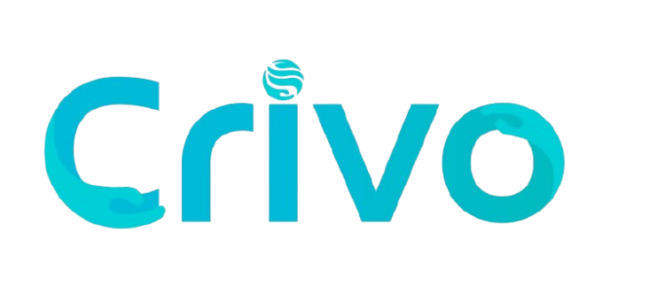

<div align="center">



# CRIVO — Inteligência e Gestão de Consumo de Água

**Fim da surpresa no fim do mês: telemetria inteligente, detecção precoce de vazamentos e decomposição explicável da conta condominial.**

[](https://www.typescriptlang.org/)
[](https://vitejs.dev/)
[](https://www.python.org/)
[](https://scikit-learn.org/)
[](https://vitest.dev/)
[]()

---

*Projeto Integrador de Inteligência Artificial — UniEVANGÉLICA (3º Período)*

</div>

<br />

## 📑 Sumário

- [Visão Geral e Contexto](#-visão-geral-e-contexto)
- [A Dor do Mercado e o Diagnóstico](#-a-dor-do-mercado-e-o-diagnóstico)
- [A Solução Crivo](#-a-solução-crivo)
  - [O Modelo de Decomposição](#o-modelo-de-decomposição)
  - [Inteligência Artificial e Detecção de Vazamentos](#inteligência-artificial-e-detecção-de-vazamentos)
- [Identidade Visual e Design System](#-identidade-visual-e-design-system)
- [Arquitetura do Repositório](#-arquitetura-do-repositório)
- [Instalação e Execução](#-instalação-e-execução)
  - [Pré-requisitos](#pré-requisitos)
  - [Frontend (Vite + TypeScript)](#frontend-vite--typescript)
  - [Backend & Pipeline de Dados (Python)](#backend--pipeline-de-dados-python)
- [Contrato de Integração da API](#-contrato-de-integração-da-api)
- [Padrões de Engenharia e Segurança](#-padrões-de-engenharia-e-segurança)
- [Equipe e Créditos](#-equipe-e-créditos)

---

## 🌊 Visão Geral e Contexto

O **Crivo** é um ecossistema de software concebido para resolver um dos gargalos operacionais e financeiros mais críticos na gestão condominial: **o desperdício invisível e a ineficiência no consumo de água**. 

Em condomínios residenciais e comerciais, a medição tradicional ocorre com periodicidade mensal por parte das concessionárias de saneamento. Quando o síndico ou os condôminos tomam conhecimento de um pico no consumo, a conta já foi fechada, o impacto financeiro foi consolidado e milhares de litros de água potável foram perdidos.

O Crivo combina **telemetria contínua / lançamento assistido de hidrômetros**, **modelagem preditiva baseada em Machine Learning** e uma **interface moderna de explicabilidade financeira**.

---

## ⚠️ A Dor do Mercado e o Diagnóstico

Durante as pesquisas de campo e entrevistas técnicas com síndicos e administradoras de condomínios (registradas no Relatório Técnico do Marco 1), foram identificados três problemas estruturais:

1. **A Assimetria de Informação e Diagnósticos Tardios**:
   - Um vazamento em válvula de descarga ou caixa acoplada gera perda de **40 a 100 litros por hora**. Em 30 dias de ciclo de medição da concessionária, isso representa entre **28.000 e 72.000 litros desperdiçados** por uma única unidade.
   - O aviso só chega de 30 a 45 dias depois, com a entrega da fatura física.

2. **O Efeito Punitivo das Faixas Tarifárias (Bandas Progressivas)**:
   - As tarifas de água não são lineares; operam em faixas progressivas. Quando o condomínio salta de faixa (ex: de $10\text{ m}^3$ para $15\text{ m}^3$), o valor por metro cúbico pode dobrar ou triplicar retroativamente sobre o volume excedente.
   - Os gestores não entendem por que uma elevação modesta de 8% no volume consumido às vezes gera um aumento de 35% no valor monetário da fatura.

3. **Ausência de Ferramentas Explicáveis para Moradores e Síndicos**:
   - As soluções existentes se resumem a planilhas manuais ou sistemas de telemetria frios, repletos de gráficos complexos sem tradução financeira imediata.

---

## 💡 A Solução Crivo

O Crivo atua na raiz desses problemas por meio de três pilares:

### O Modelo de Decomposição

A aplicação abandona a simples exibição do valor bruto da fatura e introduz o **modelo aditivo de decomposição transparente**:

$$\text{Valor Total (R\$)} = \text{Consumo Esperado} + \text{Penalidade Tarifária} + \text{Uso Acima da Média}$$

```
┌────────────────────────────────────────────────────────────────────────┐
│ TOTAL DA CONTA: R$ 4.850,00                                           │
├───────────────────────────────┬───────────────────────┬────────────────┤
│ 🔵 Consumo Esperado: R$ 3.120 │ 🟠 Tarifa: R$ 890,00  │ 🔴 Acima: R$ 840
│    (64,3% do total)           │    (18,4% do total)   │    (17,3%)     │
└───────────────────────────────┴───────────────────────┴────────────────┘
```

- **Consumo Esperado (R$)**: O volume previsto pela rotina padrão das unidades valorado na tarifa base.
- **Efeito Tarifa (R$)**: Custo adicional decorrente exclusivamente do salto de faixa ou reajuste da estrutura tarifária da concessionária.
- **Uso Acima do Esperado (R$)**: O valor monetário diretamente atribuído a vazamentos, reformas ou desvios de conduta identificados.

### Inteligência Artificial e Detecção de Vazamentos

O pipeline de dados do Crivo conta com modelos treinados em `scikit-learn` voltados para séries temporais de consumo:

1. **Alerta de Vazão Noturna Mínima (Madrugada)**:
   - Monitoramento analítico do fluxo contínuo entre **00h00 e 05h00**. Em condições normais, o consumo noturno de repouso tende a zero. Vazões sustentadas acima do limiar calibrado ($\ge 40\text{ L/h}$) acionam alarme prioritário de vazamento contínuo.
2. **Modelo Preditivo Supervisionado (+2$\sigma$)**:
   - Modelo preditivo diário com sazonalidade e histórico, calibrado com desvio residual ($\sigma$).
   - Desvios superiores a $+2\sigma$ disparam alertas de anomalia comportamental antes do fechamento do ciclo.
3. **Métricas Validadas**:
   - **MAE do Baseline Histórico**: $2.807,7\text{ L/dia}$ ($R^2 = -0.057$)
   - **MAE do Modelo Crivo**: $229,4\text{ L/dia}$ ($R^2 = 0.993$)
   - **Melhora Percentual**: **$91,8\%$ de redução no erro absoluto médio** no conjunto de testes.

---

## 🎨 Identidade Visual e Design System

O frontend do Crivo foi construído sobre uma identidade visual refinada, ancorada em uma paleta oficial de 23 cores distribuídas em tokens semânticos:

| Família Semântica | Hex Code | Aplicação no Sistema |
| :--- | :--- | :--- |
| **Tinta (Profundidade)** | `#10262B`, `#17363C`, `#2F4A50` | Fundo dark da barra de navegação, tipografia de alto contraste, headers |
| **Ardósia & Neutros** | `#4B6170`, `#6B8190`, `#7C8F96`, `#8FA5B3` | Textos secundários, bordas estruturais, rótulos de dados |
| **Turquesa (Acento Primário)** | `#00BBC6`, `#00BBD5`, `#00CFDA`, `#0B7285`, `#00B9D9`, `#00BBD7` | Ações principais, indicadores de consumo esperado, botões, gráficos |
| **Alerta & Penalidade** | `#C2410C`, `#8A2F0A`, `#F08A5D`, `#FDEBDD` | Destaque do Efeito Tarifa, anomalias críticas, tags de vazamento |
| **Papel & Névoa (Fundos)** | `#FFFFFF`, `#F5F2EA`, `#DCE3E0`, `#C9D6D4`, `#9DB2B5`, `#CFCFCF` | Superfícies limpas, cards em elevação, backgrounds de tabelas |

- **Tipografia**:
  - `Poppins` (Google Fonts): Títulos, call-to-actions, estrutura de interface.
  - `IBM Plex Mono` (Google Fonts): Índices numéricos, leituras de hidrômetro em $\text{m}^3$, valores monetários em $\text{R\$}$.

---

## 🏗️ Arquitetura do Repositório

```text
CRIVO-IA/
├── docs/                       # Documentação técnica e arquitetural
│   ├── API_CONTRACT.md         # Especificação formal da API RESTful FastAPI
│   └── ...                     # Relatórios técnicos e materiais de especificação
├── frontend/                   # Aplicação Web SPA (Single Page Application)
│   ├── public/brand/           # Logotipos oficiais e favicons vetoriais
│   ├── src/
│   │   ├── components/         # Componentes isolados (AppShell, DecompBar, Toast, Logo)
│   │   ├── core/               # Motor reativo (Router, Store, Decomposição, Formatters, DOM seguro)
│   │   ├── pages/              # Telas (Resultado/Dashboard, Leitura, Unidades, Alertas, Histórico, Auth)
│   │   ├── services/           # Camada de comunicação com a API e Mock Service Worker
│   │   └── styles/             # Design tokens e CSS modular sem dependência de Tailwind
│   ├── package.json
│   ├── tsconfig.json
│   └── vite.config.ts
├── src/                        # Núcleo de Inteligência Artificial e Backend
│   ├── api/                    # Servidor FastAPI e rotas RESTful
│   │   ├── main.py             # Ponto de entrada da API
│   │   ├── rotas/              # Controladores de rotas
│   │   └── seguranca.py        # Autenticação JWT e middlewares de segurança
│   ├── data/                   # Geração de dados sintéticos e pré-processamento
│   │   ├── gerar_sinteticos.py # Simulador físico de vazões e perfis de moradores
│   │   └── preprocessamento.py # Engenharia de features e agregação horária/diária
│   ├── models/                 # Modelagem preditiva
│   │   ├── baseline.py         # Modelo ingênuo de comparação
│   │   ├── treino.py           # Pipeline de treino supervisionado
│   │   └── avaliacao.py        # Cálculo de MAE, RMSE e R²
│   └── services/               # Regras de negócio
│       ├── agregacao.py        # Consolidação de blocos e medições
│       ├── alertas.py          # Algoritmos de vazão noturna e threshold 2-sigma
│       └── custo.py            # Estrutura tarifária e conversão litros -> reais
├── reports/                    # Métricas de validação dos modelos salvos
│   └── metricas.json           # Relatório comparativo (Baseline vs. Modelo)
├── models_saved/               # Modelos serializados (.joblib)
├── requirements.txt            # Dependências Python
├── .env.example                # Template de variáveis de ambiente
└── .gitignore                  # Higienização de arquivos sensíveis e caches
```

---

## 🚀 Instalação e Execução

### Pré-requisitos
- **Node.js** v20.x ou superior (v24 LTS recomendado) e **npm**
- **Python** 3.11 ou superior
- **Git**

---

### Frontend (Vite + TypeScript)

1. **Acesse o diretório do frontend:**
   ```bash
   cd frontend
   ```

2. **Instale as dependências:**
   ```bash
   npm install
   ```

3. **Inicie o servidor de desenvolvimento:**
   ```bash
   npm run dev
   ```
   A aplicação estará disponível em `http://localhost:5173`. Por padrão, caso o backend ainda não esteja em execução, a camada de serviço ativa automaticamente o **Mock Service Layer** em memória, permitindo navegação fluida em todas as telas.

4. **Scripts úteis:**
   ```bash
   npm run test        # Executa testes unitários com Vitest
   npm run test:watch  # Executa testes em modo interativo
   npm run typecheck   # Validação estrita do compilador TypeScript (zero erros tolerados)
   npm run lint        # Análise estática com ESLint
   npm run build       # Gera bundle otimizado para produção na pasta dist/
   ```

---

### Backend & Pipeline de Dados (Python)

1. **Configure o ambiente virtual Python:**
   ```bash
   python -m venv .venv
   ```

2. **Ative o ambiente virtual:**
   - **Windows (PowerShell):**
     ```powershell
     .\.venv\Scripts\Activate.ps1
     ```
   - **Linux / macOS:**
     ```bash
     source .venv/bin/activate
     ```

3. **Instale as dependências:**
   ```bash
   pip install -r requirements.txt
   ```

4. **Execute o pipeline de inteligência artificial:**
   ```bash
   # 1. Gerar dados sintéticos de consumo e eventos de vazamento:
   python -m src.data.gerar_sinteticos

   # 2. Executar pré-processamento e engenharia de atributos:
   python -m src.data.preprocessamento

   # 3. Treinar o modelo preditivo supervisionado:
   python -m src.models.treino

   # 4. Avaliar métricas e rodar os detectores de alertas:
   python -m src.services.alertas
   ```

5. **Inicie a API FastAPI (quando configurada):**
   ```bash
   uvicorn src.api.main:app --reload --port 8000
   ```

---

## 📡 Contrato de Integração da API

A comunicação entre a interface de usuário e a camada de inteligência é estritamente tipada e padronizada. O contrato formal com schemas de request/response, códigos HTTP e payloads documentados encontra-se em:

📄 **[Visualizar Contrato Completo da API (docs/API_CONTRACT.md)](docs/API_CONTRACT.md)**

Principais endpoints mapeados:
- `POST /api/v1/auth/login` — Autenticação do gestor condominial (Bearer Token)
- `GET /api/v1/dashboard/resultado` — Indicadores consolidados, decomposição da conta e diagnóstico em linguagem natural
- `POST /api/v1/leituras` — Registro de nova leitura manual ou assistida por imagem
- `GET /api/v1/unidades` — Listagem analítica de unidades e status de risco
- `GET /api/v1/alertas` — Central de anomalias ativas (vazamentos e tarifas)
- `POST /api/v1/alertas/{id}/reconhecer` — Confirmação de tratativa de anomalia pelo gestor

---

## 🔒 Padrões de Engenharia e Segurança

- **Zero XSS no DOM**: O frontend dispensa o uso de `innerHTML` ou injeções arbitrárias de strings HTML, empregando um helper utilitário `h()` seguro que sanitiza atributos e URLs estritamente contra esquemas perigosos (`javascript:`).
- **Tratamento de Dados e LGPD**: Nomes reais de entrevistados e dados cadastrais sensíveis coletados em campo não são rastreados no controle de versão público.
- **Isolamento de Credenciais**: Arquivos `.env` e chaves de produção são bloqueados via `.gitignore`. Um template sem segredos é disponibilizado em `.env.example`.
- **Fluxo de Trabalho Git**:
  - `main`: Código estável e validado para produção.
  - `feature/*`: Novas funcionalidades.
  - `docs/*`: Atualizações de documentação técnica.
  - `fix/*`: Correções de bugs identificados.

---

## 👥 Equipe e Créditos

Projeto desenvolvido como parte do **Bacharelado em Inteligência Artificial** da **UniEVANGÉLICA** (Anápolis - GO).

- **Instituição**: UniEVANGÉLICA — Centro Universitário de Anápolis
- **Curso**: Bacharelado em Inteligência Artificial — 3º Período
- **Disciplina / Módulo**: Projeto Integrador — Monitoria e Inteligência de Consumo

---

<div align="center">
  <sub>Crivo — Transformando dados de hidrômetros em economia real e sustentabilidade hídrica.</sub>
</div>
